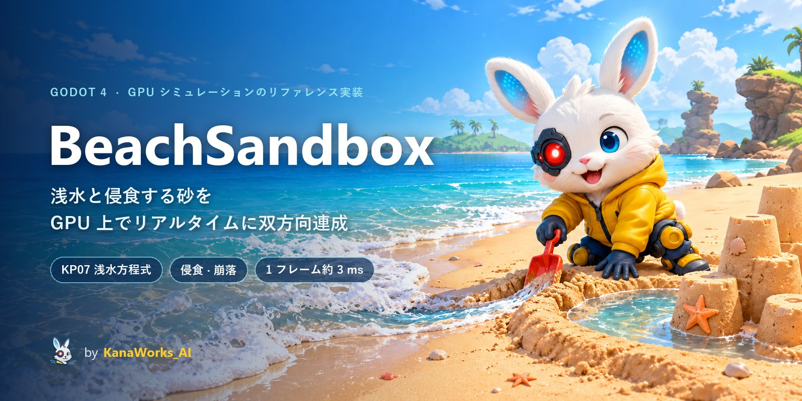
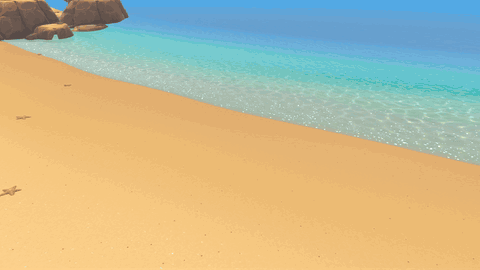
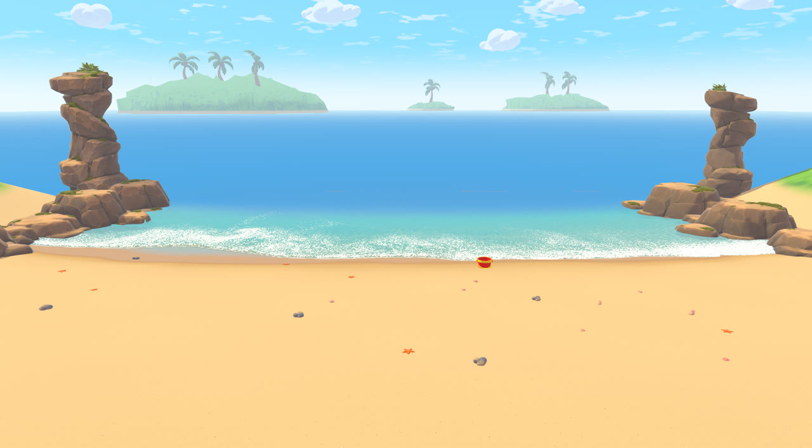
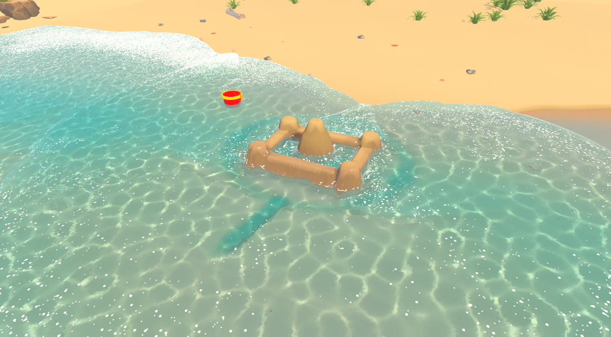
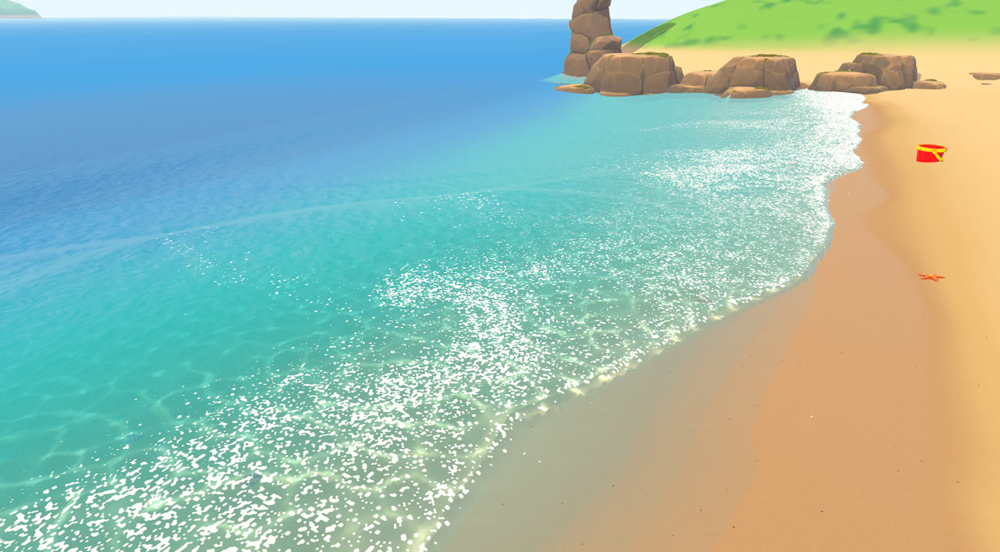
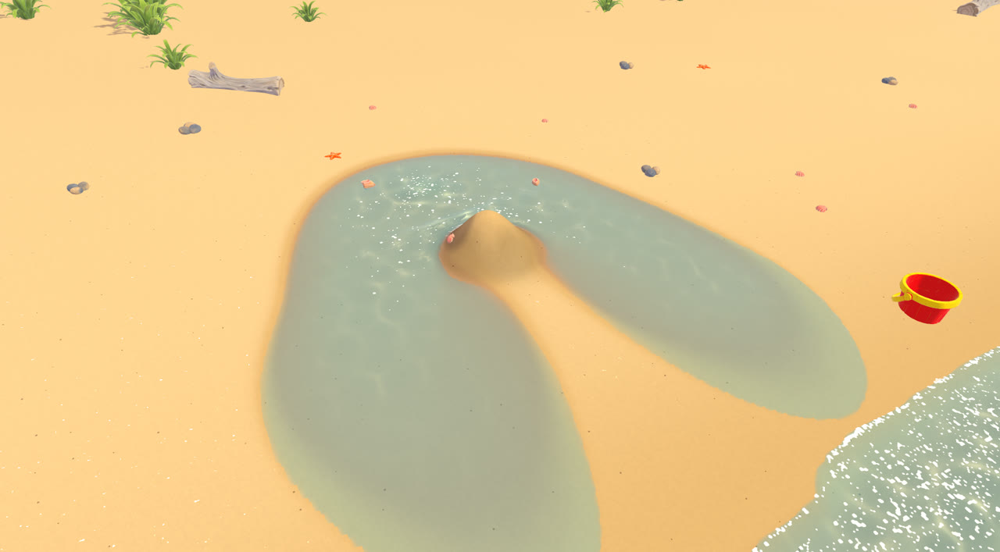
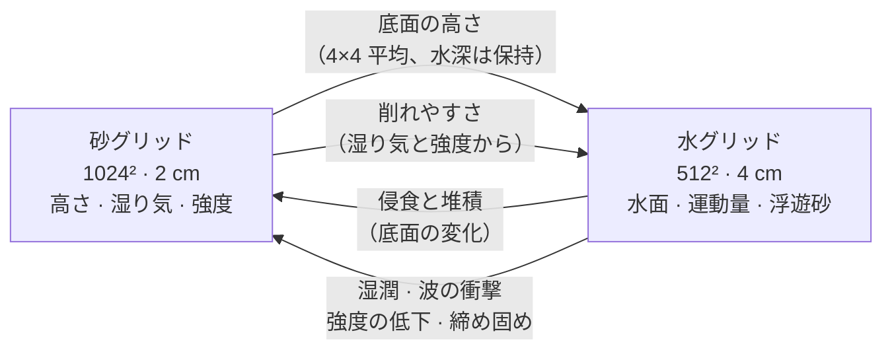
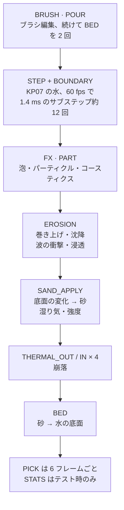

<div align="center">



<p>
  <a href="LICENSE"></a>
  <a href="https://godotengine.org"></a>
  
  
  
  <a href="https://github.com/kanaworksai-hue/beach-sandbox/stargazers"></a>
</p>

<p><a href="https://github.com/kanaworksai-hue"></a>&nbsp;<a href="https://github.com/kanaworksai-hue"><b>KanaWorks_AI のプロジェクト</b></a></p>

[English](README.md) | [简体中文](README.zh-CN.md) | **日本語**

[連成のしくみ](#-連成のしくみ) · [コードの読み方](#-コードの読み方) · [デモの実行](#-デモの実行) · [検証](#-検証) · [技術ノート](docs/TECHNICAL.md)

</div>

**BeachSandbox** は、GPU 上の浅水方程式ソルバー（Kurganov–Petrova 2007）と侵食される砂のハイトフィールドを、リアルタイムに双方向で連成させるリファレンス実装です。Godot 4.7 のコンピュートシェーダーで書かれています。水から見ると、砂は毎フレーム形が変わる底面です。砂から見ると、水は侵食・堆積・湿潤・波の衝撃をもたらします。砂のセルは湿り気と締まり具合も持っているので、同じルールのまま、固めた湿った壁は波に耐え、乾いたゆるい砂山は平らに流されます。スクリプトで決め打ちしている現象はありません。ビーチのシーンとブラシは、連成を動かして目に見えるようにするためのもので、ゲームではありません。

<p align="center">
  
  <br><sub>リアルタイムのキャプチャ。ブラシで溝を掘ると水中の底面が変わり、次に来た波が溝を通ってプールに流れ込みます。</sub>
</p>

## ✨ 示していること

<table>
<tr>
<td align="center" width="25%">🏖️<br><b>動く底面</b><br><sub>水の底面を毎フレーム砂から作り直し、水深は保つ。下で砂が変わっても浅水ソルバーは安定したまま</sub></td>
<td align="center" width="25%">🧱<br><b>材料の状態</b><br><sub>セルごとの湿り気と強度が、削れやすさと立っていられる角度を決める。固めた湿った砂は 80°、乾いた砂は 33°、飽和したゆるい砂は 15°</sub></td>
<td align="center" width="25%">⚖️<br><b>保存的なやり取り</b><br><sub>浮遊砂は水の 4 つ目の保存量。波の衝撃は両側のセルから同じ式で計算し、崩落は gather パスで行う</sub></td>
<td align="center" width="25%">⚡<br><b>GPU で完結</b><br><sub>16 個のカーネル、RTX 3060 で 1 フレーム約 3 ms。マテリアルは <code>Texture2DRD</code> で直接読み、読み戻しは小さな非同期ピッキング用マップだけ</sub></td>
</tr>
</table>

| | |
|---|---|
|  |  |
| <sub>入り江：静的な背景の中にある 20.48 m × 20.48 m のシミュレーション範囲</sub> | <sub>砂の城を襲う嵐のうねり：波の衝撃と強度の低下</sub> |
|  |  |
| <sub>シミュレーションの流れに運ばれる泡のパーティクルとコースティクス</sub> | <sub>固めた砂山に注いだ水が回り込んで溜まる</sub> |

## 🌊 連成のしくみ

### なぜハイトフィールドなのか

水も砂もハイトフィールドで、1 本の柱につき値は 1 つ、物理にパーティクルは使っていません。1 ステップのコストは O(N³) ではなく O(N²) で済みます。底面はそのまま 2 つのシミュレーションがデータをやり取りする境界面になります。そして、砂の上の浅い水がほとんどを占める幅 20 m のビーチには、この表現がよく合っています。その代わり、水は巻き込めません。巻き込む砕波もしぶきもありません（[既知の制限](#%EF%B8%8F-既知の制限)を参照）。

### 2 枚のグリッドを双方向に連成

2 枚のグリッドは同じ 20.48 m × 20.48 m の範囲を覆います。

| グリッド | サイズ | セル | 各セルが持つ値 |
|---|---|---|---|
| **水** | 512² | 4 cm | 水面 `w = 底面 + 水深`、運動量 `hu`・`hv`、**浮遊砂** `hs` |
| **砂** | 1024² | 2 cm | **高さ**、**湿り気**、**強度**（固い／ゆるい）、新しさ（描画専用） |



砂グリッドの解像度は水グリッドの 2 倍です。両者の間のやり取りは、途中で増えたり減ったりしないように組んであります。

- **砂 → 水：** 水セルの各角は、周囲 2×2 の砂セルの平均です。面の値は 2 つの角の平均、中心は 4 つの角の平均で、結果として砂の 4×4 ボックス平均になります。
- **水 → 砂：** 侵食による底面の変化を、各方向 [1 3 3 1]/4 の重みで砂グリッドに配ります。重みの合計は元の値と同じなので、砂の体積の変化は底面の変化と正確に一致します。
- **削れやすさ：** 水セルは、その下にある 2×2 の砂セルの湿り気と強度の平均を使います。

### 1 フレームの流れ

カーネルはすべて 1 つのファイル [`shaders/compute/beach.compute`](shaders/compute/beach.compute) にあり、カーネルごとに `#define KERNEL_<NAME>` を付けて 1 回ずつコンパイルします。1 フレームでは次の順に実行します。



これは演算子分割です。水は 1 フレームに固定の小さなステップを何回も進め、侵食・湿潤・崩落はフレームの dt で 1 回だけ実行します。

### 1. 動く底面の上の水

水には浅水方程式の **Kurganov–Petrova（2007）中心風上**有限体積法を使っています。REBOOT16 の [Realistic Shoreline Waves](https://reboot16.itch.io/godot-rsw) から移植し、動く底面、浮遊砂、海の境界を加えました。ここで効いているのは KP07 の次の 2 つの性質です。

- **正値性。** 水深が負になることがありません。遡上波が乾いた浜を駆け上がり、また引いていってもソルバーが発散しません。
- **well-balanced（静水平衡）。** 水中にある凹凸のある底面の上でも、静止した水は静止したままで、底面の傾きが偽の流れを生みません。編集の後に水が動くのは、編集で実際に変わった水面の部分だけです。

KP07 の well-balanced 性は、底面が連続な区分的双線形関数で、セルの値が面の値の平均であることを前提にしています。砂から角を作り、そこから面と中心を求める（`KERNEL_BED`）ことで、この条件がそのまま満たされます。底面が変わると水面も一緒に動くので、**各セルの水深は保たれます**。水中を掘るとそこの水面が下がり、周りの水が流れ込んでくぼみを埋めます。

波は南端から入ってきます。幅 50 セルの緩和ゾーンが、状態を最大 4 つの解析的な波成分（振幅・周期・位相・角度。既定では 3 つが有効）と潮位に引き寄せ、反射波も吸収します。残り 3 辺は反射壁です。摩擦は Manning 式（n = 0.022）で、流速の上限は 4 m/s です。

### 2. 侵食と堆積

浮遊砂 `hs` は水の **4 つ目の保存量**で、質量フラックスと一緒に運ばれます。溝の上流で削られた砂は、流れが遅くなる下流で堆積します。

- **輸送容量（運べる砂の量）** = `Kc · min(h, 0.15) · max(|v| − 0.25, 0)²`。流速 25 cm/s 未満では砂を巻き上げません。
- 運んでいる砂が輸送容量より少なければ巻き上げ、多ければ余った分が沈降します（速さ `kd`）。
- セルが干上がると、運んでいた砂はその場ですべて堆積します。
- **巻き上げは砂の状態で決まります：** 速度定数は `Ke_packed + (Ke_loose − Ke_packed) · (1 − 強度)³` で、Ke_loose = 1.5/s、Ke_packed = 0.01/s、乾いた砂はさらに ×1.5 です。これが輸送容量と実際の量の差に掛かるので、固く締まった浜の砂はほとんど削れず、ゆるい砂は簡単に流されます。
- 侵食はセルごと 1 フレームあたり最大 4 mm です（`max_erosion`）。

### 3. 乾いた段差への波の衝撃

浅水方程式が作用するのは*水中*の砂だけなので、水面から出ている壁はそのままでは決して削れません。そこで**波の衝撃**の項を加えています。濡れたセルの水が、より高い乾いた隣のセルに向かって流れていると、その段差から砂を削り取ります。量は壁に向かう流速の 2 乗と、段差の削れやすさに応じて増えます。両側のセルから同じ式で計算するので、壁から落ちた砂と水に入った砂はぴったり一致します。

### 4. 湿り気

- 水に浸かった砂は 0.4/s で湿ります。
- 水面より上の砂は**地下水位**の目標値に向かって落ち着きます。目標値は海面で 0.9、海面から 0.35 m 上で 0 まで直線的に下がります（毛管上昇）。
- 湿り気は横方向に**広がります**。ゆるい砂で 12 セル²/s、固い砂で 1 セル²/s です。そのため乾いたゆるい砂山はすぐに水を吸って飽和し、崩れます。
- **浸透**は、乾いた砂の上の水を最大 4 mm/s（（1 − 湿り気）倍）で水グリッドから取り除きます。浸透そのものは砂を湿らせません。湿らせるのは上の 0.4/s の別の仕組みです。

### 5. 強度：固い砂か、ゆるい砂か

砂の城の壁と、ただ盛った砂の山とを分けるのが強度です。

- **固い砂が弱くなる**のは、急な面を速い流れが通るとき、波に叩かれるとき、そして水面より上でずっと水浸し（湿り気 > 0.9）のときです。粒のすき間が水で満たされると、粘着力が失われます。
- **穏やかな水は底面を締め固め**、強度を 0.9 まで戻します。本物の浜を波が締め固めるのと同じです。
- **堆積した砂はゆるい砂です。崩れてきた砂は元の強度の 40% を保ちます。** 1 列に強度は 1 つしか持てないので、新しい層は厚さに応じて混ざります。約 5 cm で列全体の強度が置き換わります。

### 6. 崩落と安息角

安息角より急な砂は下へ流れます。安息角は湿り気と強度で決まり、強度² で補間します。

| | 乾燥 | 湿潤 | 飽和 |
|---|---|---|---|
| **ゆるい**（強度 0） | 33° | 37° | 15°（流れる） |
| **固い**（強度 1） | 33° | 80° | 80° |

崩落は 2 パスの**保存的な gather** で、1 フレームに 4 回実行します。`THERMAL_OUT` が各セルから 8 近傍それぞれへ送る量を計算し、`THERMAL_IN` が届いた分を集めます。流れてきた砂は、自分の湿り気と強度も一緒に運びます。各セルのしきい値は毎フレーム ±15% ランダムに揺らしており、グリッド方向のアーティファクトを隠しつつ、斜面にざらっとした質感を出しています。

### まとめると：湿った壁は残り、乾いた砂山は残らない理由

`walls` シナリオでは、高さ 0.28 m の壁を 2 つ並べて作ります。片方は側面 75° の固めた湿った壁、もう片方は側面 32° の乾いたゆるい壁です。

| | 固めた湿った壁 | 乾いたゆるい壁 |
|---|---|---|
| 立っていられる角度 | 最大 80° | 33° |
| 巻き上げの速度定数 Ke | 0.01/s | 1.5/s、乾いている間は ×1.5 |
| 水の広がり方 | ゆっくり（1 セル²/s） | 速い（12 セル²/s）、飽和すると 15° まで下がる |
| 波を受けたときの平均高さ | 60 s で 0.278 m、80 s で 0.162 m | 40 s で 0.205 m、50 s で 0.179 m |

コードのどこにも「壁は残る」とは書いていません。違いは同じルールから生まれます。だから、十分長く水に浸かった壁も強度を失い、最後には崩れます。

### 保存性

シミュレーション範囲の内側では、水・浮遊砂・底面の砂は、フラックスと対になったやり取りだけで動きます。意図的な例外は、ブラシ、浸透、海の緩和ゾーン、そして濡れた／乾いた境界での h ≥ 0 のクランプです。閉じた箱でのダム崩壊（60 s、侵食と崩落あり）では、水の体積の相対的なずれは +9e-5、砂は 17.4 m³ 中 −4.8e-4 m³ でした。

### シミュレーション結果の描画

- **コピーなし：** マテリアルは `Texture2DRD` 経由でシミュレーションのテクスチャを直接読みます。読み戻すのは、マウスピッキング用に 6 フレームごとに非同期で取る 256² の最大高さマップだけです。
- **水の色はシミュレーションの水深で決めます。** デプスバッファではありません。さらに Beer–Lambert の吸収と、`fwidth(h)` で幅を測った白い水際線を加えています。
- **泡：** 262,144 個の GPU パーティクルを、砕波・段波（ボア）・遡上波の先端で生成し、シミュレーションの速度場に乗せて運びます。水が引くと砂の上に取り残されます。
- **コースティクス：** 48 個の手続き的なさざ波から作る、5.12 m でシームレスにタイルするフォトンマップを毎フレーム作り直します（約 0.25–0.3 ms）。地形シェーダーは、参照位置をシミュレーションの水面の傾きでずらし、水面の曲率で集光させます。
- **濡れた砂**は暗くなり、ゆっくり乾きます。削られたばかり・積もったばかり・崩れたばかりの砂は 20 s のあいだ明るく見えます。
- **小物は砂の表面に追従します。** 頂点シェーダーと影のパスで処理し、CPU への読み戻しはありません。下の砂が流されると貝殻も一緒に沈みます。

カーネル、バインディング、数式、パラメーターの詳細は **[docs/TECHNICAL.md](docs/TECHNICAL.md)**（英語）にまとめています。

## 🧭 コードの読み方

おすすめの順番です。

1. [`scripts/sim/beach_sim.gd`](scripts/sim/beach_sim.gd)：`_step_rt()` がフレームごとのカーネル順序です。冒頭のメンバー変数がすべての調整パラメーターで、単位は SI です。
2. [`beach.compute`](shaders/compute/beach.compute) の `KERNEL_STEP` と `KERNEL_BOUNDARY`：KP07 の水のステップと海の境界。
3. `KERNEL_BED`：砂 → 水の底面。水深を保ちます。
4. `KERNEL_EROSION` → `KERNEL_SAND_APPLY` → `KERNEL_THERMAL_OUT` / `IN`：連成の砂の側。
5. `KERNEL_FX` / `KERNEL_PART`、続けて [`terrain.gdshader`](shaders/render/terrain.gdshader) と [`water.gdshader`](shaders/render/water.gdshader)：シミュレーションの状態をどう描くか。

**ほかのエンジンで使うには：** `beach.compute` はただの GLSL コンピュートシェーダーで、Godot は先頭に `#version 450` とカーネルの `#define` を足しているだけです。移植に必要なのは、バインディング表と std140 の `Params` レイアウト（どちらも [docs/TECHNICAL.md](docs/TECHNICAL.md) とファイル冒頭にあります）、そして `_step_rt()` のディスパッチ順序です。Godot に依存するコードは `beach_sim.gd` だけです。

## 🚀 デモの実行

**必要なもの：**

- **Godot 4.7.2**（標準版。C#/.NET は不要）
- **Forward+ レンダラーと Vulkan 対応 GPU。** シミュレーションは `RenderingDevice` のコンピュートシェーダーで動くので、実際の GPU が必要です。`--headless` モードや Compatibility レンダラーでは動きません。

Godot エディターでフォルダを開いて Play を押すか、ターミナルから起動します。

```sh
godot --path .
```

初回起動時はアセットのインポートに数秒かかります。

### 操作

ブラシは、シミュレーションに手を加えてその反応を見るためのものです。

| 入力 | 操作 |
|---|---|
| 左クリック | 砂を掘る |
| 右クリック | 湿った砂を盛る（固める） |
| 中クリック / Space | 水を注ぐ |
| Alt + ドラッグ | カメラを回す |
| マウスホイール | ズーム |
| 1 / 2 / 3 / 4 | カメラ切り替え（ビーチ・壁・溝・俯瞰。壁と溝は `--scenario=walls` のビーチを映します） |
| T | 潮の満ち引き オン／オフ |
| R | シミュレーションをリセット |

白い輪がブラシの位置です。マウスのレイは、その時点の砂のハイトフィールドに沿って進めて交点を求めるので、城壁の上でも狙った場所を編集できます。

<details>
<summary><b>コマンドラインオプション</b></summary>

オプションは `--` の後ろに付けます。例：`godot --path . -- --castle --cam=castle`

| オプション | 意味 |
|---|---|
| `--scenario=cove\|walls\|flat` | 最初のビーチ。`cove` が既定（小物・岩・島あり）。`walls` は湿った壁・乾いた壁・溝があるテスト用ビーチ。 |
| `--castle` | 起動時に、完成した砂の城を入り江に置く |
| `--cam=beach\|overview\|walls\|ditch\|wet\|dry\|demo\|castle\|wide\|shore\|shallow\|top` | カメラのプリセット。`beach`（既定）は紹介動画で使った、海を望む低いアングル。 |
| `--shot=cove\|build\|wave\|collapse\|surge\|ditch\|versus\|pour` | スクリプト化したカメラショットとブラシ編集（`scripts/scene/shots.gd` 参照）。`--portrait` で 9:16 版。 |
| `--rec=DIR` | ショットのフレームを正確な 1080p JPG で保存（ショットの時計で進むので、フレーム間隔が一定） |
| `--demo=pour` | スクリプトで作った砂山と、その陸側から注ぐ水（`--cam=demo` と併用） |
| `--surge=t:tide:gain,...` | うねりのキーフレーム：シミュレーション時間に対する海面上昇と波高の倍率（cove のみ） |
| `--simp=name:value,...` | `BeachSim` の任意のメンバーを上書き。例：`strength_loss:0.12`（cove のみ） |
| `--fixed` | 1 フレームにつきちょうど 1/60 s シミュレーションを進める |
| `--steps-per-frame=N` | タイムラプス |
| `--look=m1` | カートゥーン調の代わりにフラットなデバッグ表示 |
| `--flags=N` | シミュレーション機能：1 海、2 浸透、4 侵食、8 崩落（既定は 15） |
| `--hide=water,terrain,outer,shadow,glow` | 画面の一部を非表示（プロファイリング用） |
| `--wp=…` / `--tp=…` | 水／地形マテリアルの uniform を調整（`name:value`、vec3 は `a;b;c`） |
| `--test=walls\|conservation\|pick` | 検証用の数値を出力（[検証](#-検証)参照） |
| `--bench=SECONDS` | fps とシミュレーションの GPU 時間を測って終了 |
| `--snap=T --snap-out=FILE.png` | シミュレーション時間 T でスクリーンショットを 1 枚保存して終了 |

`--flags` を使うと、連成の各部分が何をしているかをいちばん手早く確かめられます。`--flags=1` では海の波だけが動き、底面はブラシでしか変わりません。ビット 1 を外すと、南端が壁になります（閉じた箱）。
</details>

## ✅ 検証

これらのスクリプトには bash（Windows では Git Bash）と、`PATH` の通った `godot` が必要です。実行中は一時的にウィンドウが開きます。

```sh
tools/run_checks.sh walls         # 湿った壁 vs 乾いた壁 vs 溝、120 s の波
tools/run_checks.sh conservation  # 閉じた箱でのダム崩壊：水／砂の体積のずれ、最小水深
tools/run_checks.sh pick          # フル解像度のハイトフィールドに対するマウスピッキングの誤差
tools/run_checks.sh bench         # 1080p の fps とシミュレーションの GPU 時間
tools/bench_render.sh             # 描画コスト（1 要素ずつ外して計測）
tools/snap.sh out.png 30 --cam=shore   # シミュレーション時間 30 s のスクリーンショット 1 枚
```

参考値（RTX 3060）：

| 検証 | 結果 |
|---|---|
| walls、乾いた壁 | 平均高さ 40 s で 0.205 m、50 s で 0.179 m |
| walls、湿った壁 | 60 s で 0.278 m、80 s で 0.162 m |
| conservation、60 s | 水の体積の相対的なずれ +9e-5、砂 −4.8e-4 m³（17.4 m³ 中） |
| pick | 水平方向の最大誤差 2.6 cm |

## ⚡ パフォーマンス

NVIDIA RTX 3060（12 GB）で開発しています。1920×1080・MSAA 4x で、入り江のシーンは約 **80–95 fps** です。シミュレーション自体は 1 フレームあたり約 **3 ms の GPU 時間**で、そのうちコースティクスマップが 0.25–0.3 ms ほどです。

## ⚠️ 既知の制限

- ハイトフィールドはセルごとに水面の高さを 1 つしか持てないので、巻き込む砕波やしぶき、水はねはありません。
- 扱うのは浮遊砂だけで、掃流砂（底面を転がる砂）の輸送はありません。海の緩和ゾーンから出ていった浮遊砂は失われます。
- 水のステップは 1.4 ms 固定で、CFL に応じた可変ステップはありません。4 m/s の流速上限は安定性のためでもあります。サブステップは 1 フレーム最大 16 回なので、約 45 fps を下回ると水は実時間より遅く進みます。一方、侵食と崩落はフレームの dt を使い続けます（1 フレーム 4 mm の侵食上限もフレームレートに依存します）。
- 砂の列ごとに湿り気と強度は 1 つずつです。壁の内部を表面と違う状態にはできません。
- 崩落はセル単位の拡散なので、大きな砂山は流れるのではなく、ゆっくり崩れます。
- 小物は砂の表面に乗ったままで、流されたり浮いたりはしません。
- シミュレーション範囲は幅 20 m です。その外側の砂と海は静的な背景で、境目は岩の後ろに隠しています。
- 水の体積は 1 分あたり約 1e-4 増えていきます。濡れた／乾いた境界での h ≥ 0 のクランプが原因である可能性が高いです。

## 🗂️ プロジェクト構成

```
scripts/sim/beach_sim.gd       BeachSim：GPU リソース、フレームごとのカーネル順序、ブラシ API
scripts/sim/scenario.gd        初期の砂（テスト用ビーチ、入り江）
shaders/compute/beach.compute  すべてのシミュレーションカーネル（1 ファイル、カーネルごとに #define）
shaders/render/                地形、水、外周の海と砂、小物、空、島、雲
scripts/scene/                 小物、砂の城ビルダー、背景、カメラリグ、ショットスクリプト
scripts/main.gd                シーン構築、入力、テスト、ベンチマーク、録画
tools/                         検証、スクリーンショット、Blender での小物の整形
docs/TECHNICAL.md              カーネル、バインディング、数式、パラメーター
```

## ⭐ 役に立ったら

自分で水や砂を作るときの参考になった、あるいは動く底面の上の浅水ソルバーがどう組み上がっているかを知りたかった、という方は、[リポジトリのページ](https://github.com/kanaworksai-hue/beach-sandbox)で **⭐ Star** を押してもらえると嬉しいです。ほかの開発者に見つけてもらいやすくなりますし、こうした技術の解説を続ける励みになります。

質問、誤りの指摘、アイデアは [issue](https://github.com/kanaworksai-hue/beach-sandbox/issues) へどうぞ。この手法を自分のプロジェクトで使ったら、ぜひ X で [@KanaWorks_AI](https://x.com/KanaWorks_AI) を付けて見せてください。

## 📄 ライセンスとクレジット

- **本プロジェクト：** [MIT](LICENSE)、© 2026 kanaworksai-hue。
- **水のソルバーと泡の発生源：** KP07 のステップと `KERNEL_FX` の泡の発生源は REBOOT16 の [Realistic Shoreline Waves](https://reboot16.itch.io/godot-rsw)（MIT）から移植しており、`water.gdshader` の一部もそれに倣っています。詳細は [THIRD_PARTY.md](THIRD_PARTY.md)。
- **小物：** 本プロジェクトのために [Meshy](https://www.meshy.ai/) で生成し、このリポジトリの MIT ライセンスで公開しています。
- **UI フォント：** Noto Sans JP（SIL OFL 1.1）。
- **ブランド：** KanaWorks_AI の名称、ロゴ、キャラクター Kana の権利は東京AI映像合同会社に帰属し、MIT ライセンスの対象**外**です。バナーはイラストで、プロジェクトの実際の画面ではありません。[docs/brand](docs/brand/README.md) を参照してください。

見た目は Bubblebird の *Sandcastle* に着想を得ています。本プロジェクトは独自の実装で、同作とは関係ありません。

<br>

<div align="center">

<a href="https://x.com/KanaWorks_AI"></a>

<p><b>Made with ♥ by <a href="https://x.com/KanaWorks_AI">KanaWorks_AI</a></b></p>

<p><sub>この手法が役に立ったら、⭐ でほかの人にも届けてください。ほかのプロジェクト：<a href="https://github.com/kanaworksai-hue">github.com/kanaworksai-hue</a></sub></p>

</div>
