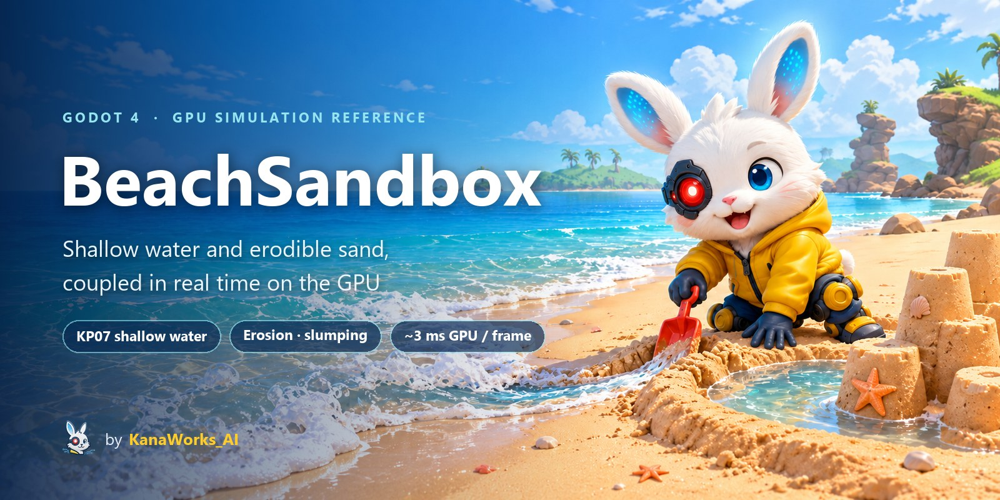
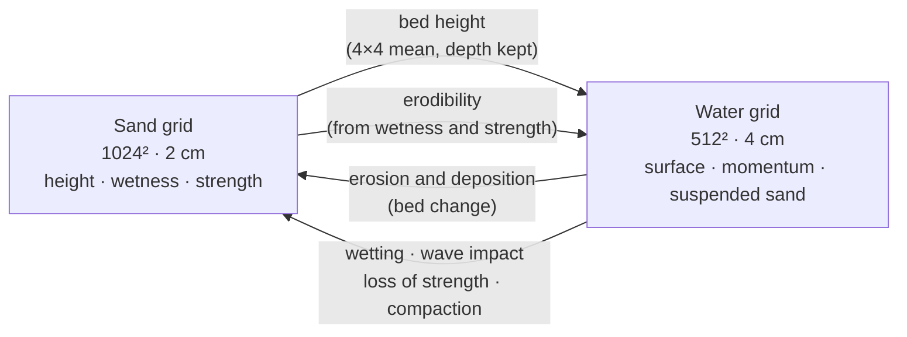
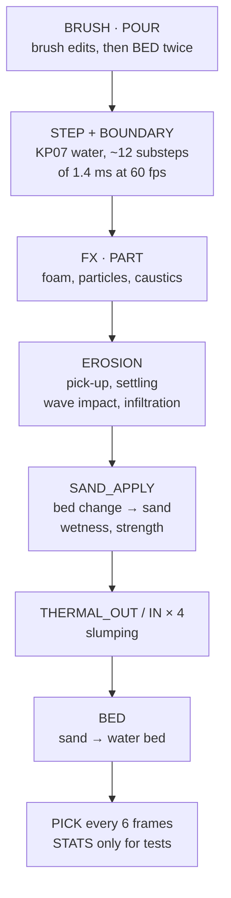

<div align="center">



<p>
  <a href="LICENSE"></a>
  <a href="https://godotengine.org"></a>
  
  
  
  <a href="https://github.com/kanaworksai-hue/beach-sandbox/stargazers"></a>
</p>

<p><a href="https://github.com/kanaworksai-hue"></a>&nbsp;<a href="https://github.com/kanaworksai-hue"><b>A KanaWorks_AI project</b></a></p>

**English** | [简体中文](README.zh-CN.md) | [日本語](README.ja.md)

[How the coupling works](#-how-the-coupling-works) · [Reading the code](#-reading-the-code) · [Running the demo](#-running-the-demo) · [Checks](#-checks) · [Technical notes](docs/TECHNICAL.md)

</div>

**BeachSandbox** is a reference implementation of real-time, two-way coupling between a GPU shallow-water solver (Kurganov–Petrova 2007) and an erodible sand heightfield, written as Godot 4.7 compute shaders. The water sees the sand as a bed that moves every frame. The sand sees the water as erosion, deposition, wetting and wave impact. Because each sand cell also stores its wetness and how packed it is, the same rules make a wet packed wall hold against the surf while a dry loose pile washes flat. Nothing is scripted. The beach scene and the brushes are there to exercise the coupling and make it visible; this is not a game.

<p align="center">
  
  <br><sub>Real-time capture. A ditch is dug with the brush; the bed changes under the water, and the next waves run up the ditch into the pool.</sub>
</p>

## ✨ What it demonstrates

<table>
<tr>
<td align="center" width="25%">🏖️<br><b>Moving bed</b><br><sub>The water bed is rebuilt from the sand every frame, keeping the water depth, so the shallow-water solver stays stable while the sand changes under it</sub></td>
<td align="center" width="25%">🧱<br><b>Material state</b><br><sub>Per-cell wetness and strength set how easily sand erodes and how steep it can stand: 80° for packed moist sand, 33° dry, 15° saturated and loose</sub></td>
<td align="center" width="25%">⚖️<br><b>Conservative transfers</b><br><sub>Suspended sand is a fourth conserved variable of the water. Wave impact is computed the same way from both cells, and slumping is a gather pass</sub></td>
<td align="center" width="25%">⚡<br><b>GPU-resident</b><br><sub>16 kernels, about 3 ms of GPU time per frame on an RTX 3060. Materials read the sim through <code>Texture2DRD</code>; the only readback is a small async pick map</sub></td>
</tr>
</table>

| | |
|---|---|
|  |  |
| <sub>The cove: 20.48 m × 20.48 m of simulated beach inside a static backdrop</sub> | <sub>Storm swell over a sandcastle: wave impact and loss of strength</sub> |
|  |  |
| <sub>Foam particles carried by the simulated flow, and caustics</sub> | <sub>Water poured onto a packed mound flows around it and pools</sub> |

## 🌊 How the coupling works

### Why heightfields

Both the water and the sand are heightfields: one value per column, no particles in the physics. That costs O(N²) per step instead of O(N³), the bed is a natural surface for the two simulations to exchange data across, and it suits a 20 m stretch of beach that is mostly shallow water over sand. The price is that the water can't overturn: there are no curling breakers or splashes (see [limitations](#%EF%B8%8F-known-limitations)).

### Two grids, coupled both ways

Both grids cover the same 20.48 m × 20.48 m area:

| Grid | Size | Cell | Each cell stores |
|---|---|---|---|
| **Water** | 512² | 4 cm | free surface `w = bed + depth`, momentum `hu`, `hv`, **suspended sand** `hs` |
| **Sand** | 1024² | 2 cm | **height**, **wetness**, **strength** (packed or loose), freshness (for rendering) |



The sand grid is twice as fine as the water grid, and the transfers between them are built so that nothing is gained or lost on the way:

- **Sand → water:** each water-cell corner is the mean of the 2×2 sand cells around it. Face values are the mean of their two corners, and the centre is the mean of the four corners, which works out to the 4×4 box mean of the sand.
- **Water → sand:** the bed change from erosion is spread onto the sand grid with [1 3 3 1]/4 weights in each direction. The weights sum to the original value, so the sand volume matches the bed change exactly.
- **Erodibility** for a water cell uses the mean wetness and strength of the 2×2 sand cells under it.

### One frame

All kernels live in one file, [`shaders/compute/beach.compute`](shaders/compute/beach.compute), compiled once per kernel with `#define KERNEL_<NAME>`. A frame runs them in this order:



This is operator splitting: the water takes many small fixed steps per frame, while erosion, wetting and slumping run once per frame with the frame's dt.

### 1. Water on a moving bed

The water uses the **Kurganov–Petrova (2007) central-upwind** finite-volume scheme for the shallow-water equations, ported from REBOOT16's [Realistic Shoreline Waves](https://reboot16.itch.io/godot-rsw) and extended with a dynamic bed, suspended sand and a sea boundary. Two properties of KP07 matter here:

- **Positivity.** The depth never goes negative, so the swash can run up a dry beach and drain off again without the solver blowing up.
- **Well-balanced.** Water at rest over a submerged uneven bed stays at rest; bed slopes don't create spurious currents. After an edit, the only motion comes from the part of the surface the edit actually changed.

KP07's well-balancing assumes a continuous, piecewise-bilinear bed whose cell value is the mean of its face values. Building the corners from the sand and deriving the faces and centre from them (`KERNEL_BED`) guarantees exactly that. When the bed changes, the free surface moves with it, so **the water depth in each cell is kept**: digging under water lowers the surface there, and the surrounding water then flows in to fill the dip.

Waves come in from the south edge. A 50-cell relaxation zone pulls the state toward up to four analytic wave components (amplitude, period, phase, angle; three are active by default) plus a tide, and absorbs reflections. The other three edges are reflecting walls. Friction is Manning with n = 0.022, and the speed is capped at 4 m/s.

### 2. Erosion and deposition

Suspended sand `hs` is the **fourth conserved variable** of the water. It is carried with the mass flux, so sand eroded at the head of a ditch is deposited downstream where the flow slows down.

- **Carrying capacity** = `Kc · min(h, 0.15) · max(|v| − 0.25, 0)²`. Below 25 cm/s no sand is picked up.
- If the water carries less than its capacity, it picks sand up. If it carries more, the excess settles (rate `kd`).
- When a cell dries, everything it was carrying settles on the spot.
- **Pick-up depends on the sand:** the rate constant is `Ke_packed + (Ke_loose − Ke_packed) · (1 − strength)³`, with Ke_loose = 1.5/s and Ke_packed = 0.01/s, ×1.5 for dry sand. It multiplies the gap between capacity and load, so packed beach sand barely erodes while loose sand washes away easily.
- Erosion is capped at 4 mm per cell and frame (`max_erosion`).

### 3. Wave impact on dry steps

The shallow-water equations only act on sand *under* the water, so a wall standing above the water would never erode. An extra **wave-impact** term handles this: a wet cell whose water moves toward a dry, higher neighbour knocks sand off that step. The amount grows with the square of the flow speed toward the wall and with the step's erodibility. It is computed the same way from both cells, so the sand that leaves the wall is exactly the sand that enters the water.

### 4. Wetness

- Sand under water wets at 0.4/s.
- Sand above the water relaxes toward a **water-table** target that falls linearly from 0.9 at sea level to 0 at 0.35 m above it (capillary rise).
- Wetness **wicks** sideways: 12 cells²/s in loose sand, 1 cell²/s in packed sand. A dry loose pile soaks up water fast, gets saturated and collapses.
- **Infiltration** removes water from the water grid at up to 4 mm/s over dry sand, scaled by (1 − wetness). It doesn't wet the sand by itself; wetting is the separate 0.4/s rate above.

### 5. Strength: packed or loose

Strength is what tells a sandcastle wall from a pile of poured sand.

- **Packed sand gets weaker** under fast flow over steep faces, when waves hit it, and when it stays soaked above the water (w > 0.9), because the water fills the gaps between the grains and the cohesion goes.
- **Calm water re-compacts** the bed toward 0.9, the way waves compact a real beach.
- **Deposited sand is loose; slumped sand keeps 40% of its source strength.** Each column stores only one strength, so a new layer blends in by thickness: about 5 cm replaces the whole column.

### 6. Slumping and the angle of repose

Sand steeper than its angle of repose flows downhill. The angle depends on wetness and strength, blended by strength²:

| | dry | moist | saturated |
|---|---|---|---|
| **loose** (strength 0) | 33° | 37° | 15° (flows) |
| **packed** (strength 1) | 33° | 80° | 80° |

Slumping runs as two **conservative gather passes**, 4 times a frame: `THERMAL_OUT` works out how much each cell sends to each of its 8 neighbours, and `THERMAL_IN` collects what arrives. Arriving sand brings its wetness and strength with it. Each cell's threshold is jittered by ±15% every frame, which hides grid-aligned artefacts and gives the slopes a grainy look.

### Put together: why the wet wall holds and the dry pile doesn't

The `walls` scenario builds two walls 0.28 m tall side by side: a wet packed one with 75° faces and a dry loose one with 32° faces.

| | Wet packed wall | Dry loose wall |
|---|---|---|
| Can stand at | up to 80° | 33° |
| Pick-up rate constant Ke | 0.01/s | 1.5/s, ×1.5 while dry |
| Wicking | slow (1 cell²/s) | fast (12 cells²/s), saturates and drops to 15° |
| Mean height under waves | 0.278 m at 60 s, 0.162 m at 80 s | 0.205 m at 40 s, 0.179 m at 50 s |

Nothing in the code says "walls hold". The difference comes out of the same rules, which is also why a wall that stays soaked long enough loses its strength and slides in the end.

### Conservation

Inside the domain, water, suspended sand and bed sand move only through fluxes and paired transfers. The deliberate exceptions are the brushes, infiltration, the sea relaxation zone and the h ≥ 0 clamp at wet/dry edges. In a closed-box dam break with erosion and slumping on (60 s), the water volume drifts by +9e-5 (relative) and the sand by −4.8e-4 m³ out of 17.4 m³.

### Rendering the simulation

- **No copies:** the materials read the simulation textures directly through `Texture2DRD`. The only readback is a 256² max-height map, fetched asynchronously every 6 frames for mouse picking.
- **Water colour comes from the simulated depth**, not the depth buffer, with Beer–Lambert absorption and a white waterline measured with `fwidth(h)`.
- **Foam:** 262,144 GPU particles spawned where waves break, at bores and at swash fronts, carried by the simulated velocity and left stranded on the sand when the water recedes.
- **Caustics:** a seamless 5.12 m photon map of 48 procedural ripple waves, rebuilt every frame (about 0.25–0.3 ms). The terrain shader shifts the lookup by the simulated surface slope and focuses it by the simulated curvature.
- **Wet sand** darkens and dries slowly. Sand that was just scoured, deposited or slid looks lighter for 20 s.
- **Props follow the sand** in the vertex shader and the shadow pass, so a shell sinks with the sand when it washes out from under it, with no CPU readback.

Every kernel, binding, formula and parameter is documented in **[docs/TECHNICAL.md](docs/TECHNICAL.md)**.

## 🧭 Reading the code

A suggested order:

1. [`scripts/sim/beach_sim.gd`](scripts/sim/beach_sim.gd): `_step_rt()` is the per-frame kernel order. The member variables at the top are every tunable, in SI units.
2. `KERNEL_STEP` and `KERNEL_BOUNDARY` in [`beach.compute`](shaders/compute/beach.compute): the KP07 water step and the sea boundary.
3. `KERNEL_BED`: sand → water bed, keeping the depth.
4. `KERNEL_EROSION` → `KERNEL_SAND_APPLY` → `KERNEL_THERMAL_OUT` / `IN`: the sand side of the coupling.
5. `KERNEL_FX` / `KERNEL_PART`, then [`terrain.gdshader`](shaders/render/terrain.gdshader) and [`water.gdshader`](shaders/render/water.gdshader): how the simulation state is drawn.

**Using it in another engine:** `beach.compute` is plain GLSL compute; Godot only prepends `#version 450` and the kernel's `#define`. To port it, you need the binding table and the std140 `Params` layout (both in [docs/TECHNICAL.md](docs/TECHNICAL.md) and at the top of the file) and the dispatch order from `_step_rt()`. The Godot-specific code is `beach_sim.gd`.

## 🚀 Running the demo

**Requirements:**

- **Godot 4.7.2** (standard build, no C#/.NET needed)
- **Forward+ renderer with a Vulkan-capable GPU.** The simulation is built on `RenderingDevice` compute shaders, so it needs a real GPU. It does not run in `--headless` mode or with the Compatibility renderer.

Open the folder in the Godot editor and press Play, or run it from a terminal:

```sh
godot --path .
```

The first launch imports the assets, which takes a few seconds.

### Controls

The brushes are there to disturb the simulation and watch it respond.

| Input | Action |
|---|---|
| Left mouse | Dig |
| Right mouse | Pile up wet (packed) sand |
| Middle mouse / Space | Pour water |
| Alt + drag | Orbit the camera |
| Mouse wheel | Zoom |
| 1 / 2 / 3 / 4 | Camera presets (beach, walls, ditch, overview; walls and ditch frame the `--scenario=walls` beach) |
| T | Toggle the tide |
| R | Reset the simulation |

The white ring shows where the brush is. The mouse ray is marched against the live sand heightfield, so the brush lands where you point, even on castle walls.

<details>
<summary><b>Command-line options</b></summary>

Pass options after `--`, for example `godot --path . -- --castle --cam=castle`.

| Option | Meaning |
|---|---|
| `--scenario=cove\|walls\|flat` | Starting beach. `cove` is the default (props, rocks, islands). `walls` is the test beach with a wet wall, a dry wall and a ditch. |
| `--castle` | Start with a finished sandcastle in the cove |
| `--cam=beach\|overview\|walls\|ditch\|wet\|dry\|demo\|castle\|wide\|shore\|shallow\|top` | Camera preset. `beach` (the default) is the low view out to sea used in the showcase video. |
| `--shot=cove\|build\|wave\|collapse\|surge\|ditch\|versus\|pour` | Scripted camera shots and brush edits (see `scripts/scene/shots.gd`). `--portrait` makes a 9:16 version. |
| `--rec=DIR` | Save the shot's frames as exact 1080p JPGs (on the shot clock, so frame timing stays even) |
| `--demo=pour` | Scripted mound plus water poured on the land side of it (use with `--cam=demo`) |
| `--surge=t:tide:gain,...` | Swell keyframes: sea level rise and wave height multiplier over simulated time (cove only) |
| `--simp=name:value,...` | Override any `BeachSim` member, e.g. `strength_loss:0.12` (cove only) |
| `--fixed` | Advance exactly 1/60 s of simulation per frame |
| `--steps-per-frame=N` | Time-lapse |
| `--look=m1` | Flat debug shading instead of the cartoon look |
| `--flags=N` | Simulation features: 1 sea, 2 infiltration, 4 erosion, 8 slumping (default 15) |
| `--hide=water,terrain,outer,shadow,glow` | Hide parts of the frame (for profiling) |
| `--wp=…` / `--tp=…` | Tweak water / terrain material uniforms (`name:value`, write vec3 as `a;b;c`) |
| `--test=walls\|conservation\|pick` | Print validation metrics (see [Checks](#-checks)) |
| `--bench=SECONDS` | Measure fps and simulation GPU time, then quit |
| `--snap=T --snap-out=FILE.png` | Save one screenshot at simulated time T, then quit |

`--flags` is the quickest way to see what each part of the coupling does. With `--flags=1` only the sea forcing runs, and the bed changes only under the brush. Without bit 1, the south edge becomes a wall (a closed box).
</details>

## ✅ Checks

These scripts need bash (Git Bash on Windows) with `godot` on `PATH`. Each one briefly opens a window.

```sh
tools/run_checks.sh walls         # wet wall vs dry wall vs ditch over 120 s of waves
tools/run_checks.sh conservation  # closed-box dam break: water / sand volume drift, minimum depth
tools/run_checks.sh pick          # mouse picking error against the full-resolution heightfield
tools/run_checks.sh bench         # 1080p fps and simulation GPU time
tools/bench_render.sh             # render cost, one part removed at a time
tools/snap.sh out.png 30 --cam=shore   # one screenshot at simulated time 30 s
```

Reference results (RTX 3060):

| Check | Result |
|---|---|
| walls, dry wall | 0.205 m mean height at 40 s, 0.179 m at 50 s |
| walls, wet wall | 0.278 m at 60 s, 0.162 m at 80 s |
| conservation, 60 s | water volume drift +9e-5 (relative), sand −4.8e-4 m³ (of 17.4 m³) |
| pick | 2.6 cm worst horizontal error |

## ⚡ Performance

Developed on an NVIDIA RTX 3060 (12 GB). At 1920×1080 with MSAA 4x, the cove scene runs at about **80–95 fps**. The simulation itself takes about **3 ms of GPU time per frame**, of which the caustic map is about 0.25–0.3 ms.

## ⚠️ Known limitations

- A heightfield has one water height per cell, so there are no curling breakers, spray or splashes.
- Only suspended load is modelled; there is no bedload transport. Suspended sand that drifts out through the sea relaxation zone is lost.
- The water step is a fixed 1.4 ms with no adaptive CFL, and the 4 m/s speed cap partly exists for stability. At most 16 substeps run per frame, so below about 45 fps the water runs slower than real time, while erosion and slumping still use the frame's dt (and the 4 mm per-frame erosion cap depends on the frame rate).
- Each sand column stores a single wetness and strength value. The inside of a wall can't differ from its surface.
- Slumping is a per-cell diffusion, so big piles collapse slowly rather than flowing.
- Props stay on the sand surface; they are never washed away and don't float.
- The simulated area is 20 m across. The sand and sea beyond it are static backdrops, and the seams are hidden behind rocks.
- The water volume drifts up by about 1e-4 per minute, most likely from the h ≥ 0 clamp at wet/dry edges.

## 🗂️ Project layout

```
scripts/sim/beach_sim.gd       BeachSim: GPU resources, per-frame kernel order, brush API
scripts/sim/scenario.gd        initial sand (test beach, cove)
shaders/compute/beach.compute  all simulation kernels (one file, one #define per kernel)
shaders/render/                terrain, water, outer sea/sand, props, sky, islands, clouds
scripts/scene/                 props, sandcastle builder, backdrop, camera rig, shot scripts
scripts/main.gd                scene setup, input, tests, benchmarks, recording
tools/                         checks, screenshots, Blender prop cleanup
docs/TECHNICAL.md              kernels, bindings, formulas and parameters
```

## ⭐ If this was useful

If the technique helped you, whether you're building water or sand of your own or just wanted to see how a moving-bed shallow-water solver fits together, a **⭐ Star** on the [repository page](https://github.com/kanaworksai-hue/beach-sandbox) helps other developers find it, and it tells me this kind of write-up is worth doing.

Questions, corrections and ideas are welcome in the [issues](https://github.com/kanaworksai-hue/beach-sandbox/issues). If you use the technique in your own project, I'd love to see it: tag [@KanaWorks_AI](https://x.com/KanaWorks_AI) on X.

## 📄 License and credits

- **This project:** [MIT](LICENSE), © 2026 kanaworksai-hue.
- **Water step and foam sources:** the KP07 solver and the foam sources in `KERNEL_FX` are ported from REBOOT16's [Realistic Shoreline Waves](https://reboot16.itch.io/godot-rsw) (MIT), as are parts of `water.gdshader`. Details are in [THIRD_PARTY.md](THIRD_PARTY.md).
- **Props:** generated with [Meshy](https://www.meshy.ai/) for this project and released under this repository's MIT license.
- **UI font:** Noto Sans JP (SIL OFL 1.1).
- **Brand:** the KanaWorks_AI name, logo and the Kana character are © 東京AI映像合同会社 (Tokyo AI Visuals LLC) and are **not** covered by the MIT license. The banner is an illustration, not a capture from the project. See [docs/brand](docs/brand/README.md).

The look is inspired by Bubblebird's *Sandcastle*. This is an independent implementation and is not affiliated with that project.

<br>

<div align="center">

<a href="https://x.com/KanaWorks_AI"></a>

<p><b>Made with ♥ by <a href="https://x.com/KanaWorks_AI">KanaWorks_AI</a></b></p>

<p><sub>If the technique was useful, a ⭐ helps others find it. More projects: <a href="https://github.com/kanaworksai-hue">github.com/kanaworksai-hue</a></sub></p>

</div>
