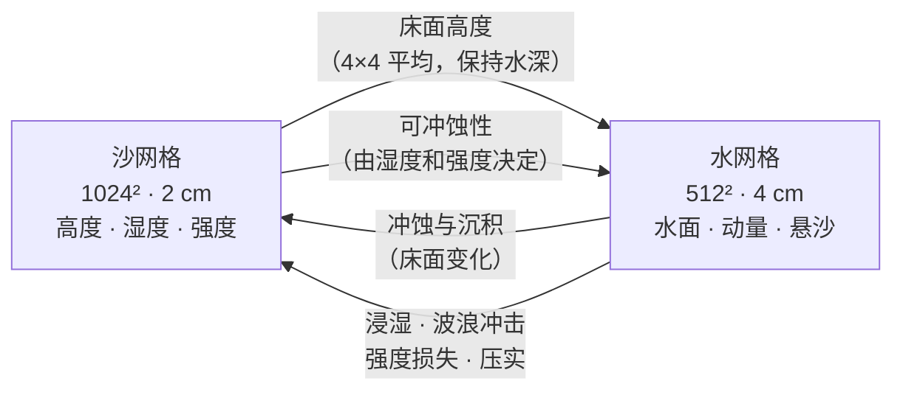
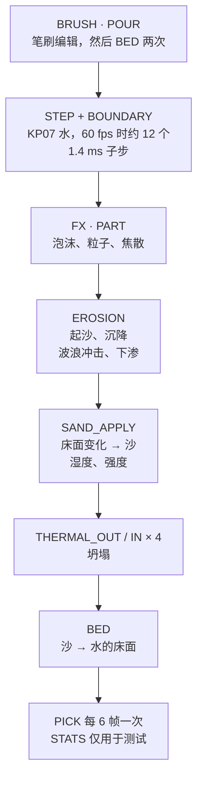

<div align="center">


<p>
  <a href="LICENSE"></a>
  <a href="https://godotengine.org"></a>
  
  
  
  <a href="https://github.com/kanaworksai-hue/beach-sandbox/stargazers"></a>
</p>

<p><a href="https://github.com/kanaworksai-hue"></a>&nbsp;<a href="https://github.com/kanaworksai-hue"><b>KanaWorks_AI 出品</b></a></p>

[English](README.md) | **简体中文** | [日本語](README.ja.md)

[耦合原理](#-耦合原理) · [阅读代码](#-阅读代码) · [运行演示](#-运行演示) · [验证](#-验证) · [技术文档](docs/TECHNICAL.md)

</div>

**BeachSandbox** 是一个参考实现，演示如何在 GPU 上实时、双向地耦合浅水方程求解器（Kurganov–Petrova 2007）和一张可冲蚀的沙面高度场，用 Godot 4.7 的 compute shader 编写。对水来说，沙是一个每帧都在变化的床面；对沙来说，水带来冲蚀、沉积、浸湿和波浪冲击。每个沙单元还记录了自己的湿度和压实程度，所以同一套规则既能让压实的湿沙墙扛住海浪，也能让一堆松散的干沙被冲平。这些现象都不是脚本写死的。海滩场景和笔刷只是用来驱动耦合、让效果看得见；这不是一个游戏。

<p align="center">
  
  <br><sub>实时录制。用笔刷挖出一条沟，水下的床面随之改变，接下来的几道浪就顺着沟冲进了水池。</sub>
</p>

## ✨ 演示了什么

<table>
<tr>
<td align="center" width="25%">🏖️<br><b>动态床面</b><br><sub>每帧从沙重建水的床面，并保持水深不变，所以沙在下面变化时浅水求解器依然稳定</sub></td>
<td align="center" width="25%">🧱<br><b>材料状态</b><br><sub>每个单元的湿度和强度决定沙有多容易被冲走、能立多陡：压实的潮湿沙 80°，干沙 33°，饱和的松散沙 15°</sub></td>
<td align="center" width="25%">⚖️<br><b>守恒的转移</b><br><sub>悬沙是水的第四个守恒量。波浪冲击从两侧用同一公式计算，坍塌用 gather pass 完成</sub></td>
<td align="center" width="25%">⚡<br><b>全程在 GPU</b><br><sub>16 个 kernel，在 RTX 3060 上每帧约 3 ms GPU 时间。材质通过 <code>Texture2DRD</code> 直接读模拟数据，唯一的回读是一张小的异步拾取图</sub></td>
</tr>
</table>

| | |
|---|---|
|  |  |
| <sub>海湾：静态背景中 20.48 m × 20.48 m 的模拟区域</sub> | <sub>风暴涌浪冲击沙堡：波浪冲击与强度损失</sub> |
|  |  |
| <sub>随模拟水流漂动的泡沫粒子和焦散</sub> | <sub>浇在压实沙堆上的水绕过沙堆积成水洼</sub> |

## 🌊 耦合原理

### 为什么用高度场

水和沙都是高度场：每一列只有一个值，物理部分不用粒子。每步的开销是 O(N²) 而不是 O(N³)；床面天然就是两套模拟交换数据的界面；而 20 m 宽、以沙上浅水为主的海滩也正适合这种表示。代价是水不能翻卷：没有卷起的碎浪，也没有水花（见[已知限制](#%EF%B8%8F-已知限制)）。

### 两张网格，双向耦合

两张网格覆盖同一块 20.48 m × 20.48 m 的区域：

| 网格 | 大小 | 单元 | 每个单元存储 |
|---|---|---|---|
| **水** | 512² | 4 cm | 自由水面 `w = 床面 + 水深`、动量 `hu`、`hv`、**悬沙** `hs` |
| **沙** | 1024² | 2 cm | **高度**、**湿度**、**强度**（压实或松散）、新鲜度（仅用于渲染） |



沙网格的分辨率是水网格的两倍，两者之间的转移经过设计，不会在中途凭空增减：

- **沙 → 水：** 水单元的每个角点取周围 2×2 个沙单元的平均。面上的值取两个角点的平均，中心取四个角点的平均，结果正好等于沙的 4×4 方框平均。
- **水 → 沙：** 冲蚀造成的床面变化，在每个方向上按 [1 3 3 1]/4 的权重分配到沙网格上。权重之和等于原值，所以沙的体积变化和床面变化完全一致。
- **可冲蚀性：** 一个水单元使用它下面 2×2 个沙单元的平均湿度和强度。

### 一帧的流程

所有 kernel 都在同一个文件 [`shaders/compute/beach.compute`](shaders/compute/beach.compute) 里，每个 kernel 加上 `#define KERNEL_<NAME>` 单独编译一次。一帧按下面的顺序执行：



这是算子分裂：水每帧走很多个固定的小步，而冲蚀、浸湿和坍塌每帧只用帧的 dt 执行一次。

### 1. 动态床面上的水

水使用浅水方程的 **Kurganov–Petrova（2007）中心迎风**有限体积格式，移植自 REBOOT16 的 [Realistic Shoreline Waves](https://reboot16.itch.io/godot-rsw)，并加上了动态床面、悬沙和海洋边界。KP07 的两个性质在这里很关键：

- **保正性。** 水深永远不会变成负数，所以上冲流可以爬上干燥的沙滩再退下去，求解器不会发散。
- **well-balanced（静水平衡）。** 淹没在水下的不平整床面上，静止的水保持静止，床面坡度不会产生虚假的水流。编辑之后，水只会因为编辑真正改变了的那部分水面而运动。

KP07 的 well-balanced 性质要求床面是连续的分片双线性函数，且单元值等于各面值的平均。先从沙算出角点，再由角点推出面值和中心（`KERNEL_BED`），正好满足这个条件。床面变化时，自由水面跟着一起移动，所以**每个单元的水深保持不变**：在水下挖坑，那里的水面会随之降低，然后周围的水流进来把凹陷填平。

海浪从南边界进入。一个 50 单元宽的松弛区把状态拉向最多四个解析波分量（振幅、周期、相位、角度；默认有三个生效）加上潮位，同时吸收反射波。另外三条边是反射墙。摩擦采用 Manning 公式，n = 0.022，流速上限 4 m/s。

### 2. 冲蚀与沉积

悬沙 `hs` 是水的**第四个守恒量**，跟着质量通量一起输运。所以沟头被冲走的沙，会在下游流速变慢的地方沉积下来。

- **挟沙能力** = `Kc · min(h, 0.15) · max(|v| − 0.25, 0)²`。流速低于 25 cm/s 时不起沙。
- 水里带的沙少于挟沙能力就起沙；多于挟沙能力，多出的部分就沉降（速率 `kd`）。
- 一个单元干掉时，它携带的沙全部就地沉积。
- **起沙取决于沙本身：** 速率常数为 `Ke_packed + (Ke_loose − Ke_packed) · (1 − 强度)³`，其中 Ke_loose = 1.5/s，Ke_packed = 0.01/s，干沙再乘 1.5。它乘在挟沙能力与实际含沙量的差上，所以压实的沙滩几乎冲不动，松散的沙一冲就走。
- 每个单元每帧最多冲蚀 4 mm（`max_erosion`）。

### 3. 波浪冲击干燥的台阶

浅水方程只作用于*水下*的沙，露出水面的墙永远不会被冲蚀。额外的**波浪冲击**项处理这种情况：如果一个湿单元的水正朝着一个更高的干燥邻居流去，就会从这个台阶上敲下沙子。敲下的量随朝向墙的流速平方和台阶的可冲蚀性增大。两个单元用同一个公式计算，所以墙上掉下的沙正好等于进入水里的沙。

### 4. 湿度

- 被水淹没的沙以 0.4/s 的速度变湿。
- 水面以上的沙会趋向一个**地下水位**目标值：海平面处为 0.9，线性下降到海平面以上 0.35 m 处为 0（毛细上升）。
- 湿度会向四周**扩散**：松散沙 12 格²/s，压实沙 1 格²/s。所以一堆松散的干沙吸水很快，很快饱和，然后塌掉。
- **下渗**会以最高 4 mm/s 的速度把干沙上方的水从水网格中移除，再乘以（1 − 湿度）。它本身不会让沙变湿；变湿靠的是上面那个独立的 0.4/s 速率。

### 5. 强度：压实还是松散

强度就是沙堡的墙和一堆倒出来的沙的区别。

- **压实的沙会变弱**：陡面上有快速水流时、被海浪拍打时，以及在水面以上长时间泡透（湿度 > 0.9）时——水填满了沙粒之间的空隙，黏结力就没了。
- **平静的水会把床面重新压实**到 0.9，就像真实的海浪压实沙滩一样。
- **沉积下来的沙是松散的；坍塌下来的沙保留原来强度的 40%。** 每一列只存一个强度值，所以新的一层按厚度混合进去：大约 5 cm 就会替换整列的强度。

### 6. 坍塌与休止角

比休止角更陡的沙会往下流。休止角取决于湿度和强度，按强度²插值：

| | 干 | 潮湿 | 饱和 |
|---|---|---|---|
| **松散**（强度 0） | 33° | 37° | 15°（会流动） |
| **压实**（强度 1） | 33° | 80° | 80° |

坍塌由两遍**守恒的 gather pass** 完成，每帧 4 次：`THERMAL_OUT` 算出每个单元要分给 8 个邻居各多少沙，`THERMAL_IN` 收集流入的沙。流过来的沙会带着自己的湿度和强度。每个单元的阈值每帧随机抖动 ±15%，这样能掩盖沿网格方向的痕迹，也让斜坡看起来有颗粒感。

### 合在一起：为什么湿墙站得住，干沙堆站不住

`walls` 场景并排建了两堵 0.28 m 高的墙：一堵是压实的湿墙，侧面 75°；另一堵是松散的干墙，侧面 32°。

| | 压实的湿墙 | 松散的干墙 |
|---|---|---|
| 能立住的角度 | 最高 80° | 33° |
| 起沙速率常数 Ke | 0.01/s | 1.5/s，干燥时再 ×1.5 |
| 吸水扩散 | 慢（1 格²/s） | 快（12 格²/s），饱和后降到 15° |
| 浪中的平均高度 | 60 s 时 0.278 m，80 s 时 0.162 m | 40 s 时 0.205 m，50 s 时 0.179 m |

代码里没有任何一处写着"墙要站得住"。差别完全来自同一套规则，这也是为什么一堵墙泡水泡得够久，强度也会丢掉，最后同样会滑塌。

### 守恒

在模拟区域内部，水、悬沙和床面的沙只通过通量和成对的转移来移动。有意保留的例外是：笔刷、下渗、海洋松弛区，以及干湿边界上 h ≥ 0 的截断。在封闭水箱的溃坝测试中（60 s，冲蚀和坍塌都开启），水体积相对漂移 +9e-5，沙在 17.4 m³ 中漂移 −4.8e-4 m³。

### 模拟结果怎么画出来

- **不拷贝：** 材质通过 `Texture2DRD` 直接读取模拟纹理。唯一的回读是一张 256² 的最大高度图，每 6 帧异步取一次，用于鼠标拾取。
- **水的颜色来自模拟出的水深**，而不是深度缓冲，再加上 Beer–Lambert 吸收，以及用 `fwidth(h)` 量出的白色水边线。
- **泡沫：** 262,144 个 GPU 粒子，在破浪处、涌波（bore）处和上冲流前沿生成，随模拟的速度场漂动，退水后留在沙滩上。
- **焦散：** 由 48 个程序化波纹组成、5.12 m 无缝平铺的光子图，每帧重建（约 0.25–0.3 ms）。地形着色器按模拟水面的坡度偏移查找位置，并按模拟水面的曲率聚焦。
- **湿沙**颜色变深，慢慢变干。刚被冲刷、沉积或滑落的沙会在 20 s 内显得更浅。
- **道具跟随沙面**，在顶点着色器和阴影 pass 里完成，不需要 CPU 回读，所以沙子被冲走时，贝壳会跟着一起下沉。

所有 kernel、绑定、公式和参数都写在 **[docs/TECHNICAL.md](docs/TECHNICAL.md)**（英文）里。

## 🧭 阅读代码

建议的阅读顺序：

1. [`scripts/sim/beach_sim.gd`](scripts/sim/beach_sim.gd)：`_step_rt()` 就是每帧的 kernel 顺序。开头的成员变量是所有可调参数，单位都是 SI。
2. [`beach.compute`](shaders/compute/beach.compute) 中的 `KERNEL_STEP` 和 `KERNEL_BOUNDARY`：KP07 的水步进和海洋边界。
3. `KERNEL_BED`：沙 → 水的床面，保持水深。
4. `KERNEL_EROSION` → `KERNEL_SAND_APPLY` → `KERNEL_THERMAL_OUT` / `IN`：耦合中沙的一侧。
5. `KERNEL_FX` / `KERNEL_PART`，然后是 [`terrain.gdshader`](shaders/render/terrain.gdshader) 和 [`water.gdshader`](shaders/render/water.gdshader)：模拟状态是怎么画出来的。

**移植到其他引擎：** `beach.compute` 是普通的 GLSL compute 代码，Godot 只在前面加上 `#version 450` 和该 kernel 的 `#define`。移植时需要绑定表和 std140 的 `Params` 布局（都在 [docs/TECHNICAL.md](docs/TECHNICAL.md) 和文件开头），以及 `_step_rt()` 里的 dispatch 顺序。和 Godot 相关的代码只有 `beach_sim.gd`。

## 🚀 运行演示

**环境要求：**

- **Godot 4.7.2**（标准版，不需要 C#/.NET）
- **Forward+ 渲染器和支持 Vulkan 的显卡。** 模拟基于 `RenderingDevice` 的 compute shader，需要真正的 GPU。不能在 `--headless` 模式或 Compatibility 渲染器下运行。

在 Godot 编辑器里打开这个文件夹并按 Play，或者在终端里运行：

```sh
godot --path .
```

第一次启动会导入资源，需要几秒钟。

### 操作

笔刷的作用是扰动模拟，观察它如何响应。

| 输入 | 操作 |
|---|---|
| 鼠标左键 | 挖沙 |
| 鼠标右键 | 堆湿沙（压实） |
| 鼠标中键 / 空格 | 浇水 |
| Alt + 拖动 | 旋转镜头 |
| 鼠标滚轮 | 缩放 |
| 1 / 2 / 3 / 4 | 镜头预设（海滩、墙、沟、俯瞰；墙和沟对准的是 `--scenario=walls` 的海滩） |
| T | 开关潮汐 |
| R | 重置模拟 |

白色圆环表示笔刷的位置。鼠标射线是沿着实时的沙面高度场步进求交的，所以就算在城墙上，笔刷也会落在你指的地方。

<details>
<summary><b>命令行参数</b></summary>

参数放在 `--` 后面，例如 `godot --path . -- --castle --cam=castle`。

| 参数 | 含义 |
|---|---|
| `--scenario=cove\|walls\|flat` | 初始海滩。`cove` 为默认（有道具、岩石、小岛）。`walls` 是测试用海滩，有一堵湿墙、一堵干墙和一条沟。 |
| `--castle` | 启动时直接在海湾里生成一座建好的沙堡 |
| `--cam=beach\|overview\|walls\|ditch\|wet\|dry\|demo\|castle\|wide\|shore\|shallow\|top` | 镜头预设。`beach`（默认）是展示视频里那个望向大海的低机位。 |
| `--shot=cove\|build\|wave\|collapse\|surge\|ditch\|versus\|pour` | 脚本化的镜头和笔刷编辑（见 `scripts/scene/shots.gd`）。加 `--portrait` 输出 9:16 版本。 |
| `--rec=DIR` | 把镜头的每一帧存成精确的 1080p JPG（按镜头时钟，帧间隔均匀） |
| `--demo=pour` | 脚本生成的沙堆，并在它靠陆地的一侧浇水（配合 `--cam=demo`） |
| `--surge=t:tide:gain,...` | 涌浪关键帧：随模拟时间变化的海平面抬升和波高倍数（仅 cove） |
| `--simp=name:value,...` | 覆盖任意 `BeachSim` 成员，例如 `strength_loss:0.12`（仅 cove） |
| `--fixed` | 每帧精确推进 1/60 s 的模拟 |
| `--steps-per-frame=N` | 延时摄影 |
| `--look=m1` | 用平面调试着色代替卡通风格 |
| `--flags=N` | 模拟功能：1 海浪、2 下渗、4 冲蚀、8 坍塌（默认 15） |
| `--hide=water,terrain,outer,shadow,glow` | 隐藏画面的一部分（用于性能分析） |
| `--wp=…` / `--tp=…` | 调整水 / 地形材质的 uniform（`name:value`，vec3 写成 `a;b;c`） |
| `--test=walls\|conservation\|pick` | 输出验证指标（见[验证](#-验证)） |
| `--bench=SECONDS` | 测量 fps 和模拟的 GPU 时间，然后退出 |
| `--snap=T --snap-out=FILE.png` | 在模拟时间 T 截一张图，然后退出 |

用 `--flags` 最快能看出耦合的每一部分起什么作用。`--flags=1` 时只有海浪驱动在运行，床面只在笔刷下改变。去掉第 1 位，南边界就变成一堵墙（封闭水箱）。
</details>

## ✅ 验证

这些脚本需要 bash（Windows 上用 Git Bash），并且 `godot` 在 `PATH` 里。每个脚本都会短暂打开一个窗口。

```sh
tools/run_checks.sh walls         # 湿墙 vs 干墙 vs 沟，120 s 海浪
tools/run_checks.sh conservation  # 封闭水箱溃坝：水 / 沙体积漂移、最小水深
tools/run_checks.sh pick          # 鼠标拾取相对全分辨率高度场的误差
tools/run_checks.sh bench         # 1080p fps 和模拟 GPU 时间
tools/bench_render.sh             # 渲染开销，每次去掉一部分
tools/snap.sh out.png 30 --cam=shore   # 在模拟时间 30 s 截一张图
```

参考结果（RTX 3060）：

| 验证 | 结果 |
|---|---|
| walls，干墙 | 40 s 时平均高度 0.205 m，50 s 时 0.179 m |
| walls，湿墙 | 60 s 时 0.278 m，80 s 时 0.162 m |
| conservation，60 s | 水体积相对漂移 +9e-5，沙 −4.8e-4 m³（共 17.4 m³） |
| pick | 最大水平误差 2.6 cm |

## ⚡ 性能

在 NVIDIA RTX 3060（12 GB）上开发。1920×1080、MSAA 4x 下，海湾场景约 **80–95 fps**。模拟本身每帧约 **3 ms GPU 时间**，其中焦散图约占 0.25–0.3 ms。

## ⚠️ 已知限制

- 高度场每个单元只有一个水面高度，所以没有卷起的碎浪、水花和飞溅。
- 只模拟了悬移质，没有推移质输运。从海洋松弛区漂出去的悬沙会丢失。
- 水的步长固定为 1.4 ms，没有自适应 CFL，4 m/s 的流速上限部分是为了稳定。每帧最多 16 个子步，所以低于约 45 fps 时，水会比真实时间慢，而冲蚀和坍塌仍然使用帧的 dt（每帧 4 mm 的冲蚀上限也因此依赖帧率）。
- 每一列沙只存一个湿度和强度，墙的内部无法和表面不同。
- 坍塌是逐单元的扩散，所以大沙堆是慢慢塌下来的，而不是流下来的。
- 道具始终贴在沙面上，不会被冲走，也不会浮起来。
- 模拟区域宽 20 m。区域外的沙和海是静态背景，接缝藏在岩石后面。
- 水体积每分钟大约上漂 1e-4，最可能来自干湿边界上 h ≥ 0 的截断。

## 🗂️ 项目结构

```
scripts/sim/beach_sim.gd       BeachSim：GPU 资源、每帧 kernel 顺序、笔刷 API
scripts/sim/scenario.gd        初始沙面（测试海滩、海湾）
shaders/compute/beach.compute  所有模拟 kernel（一个文件，每个 kernel 一个 #define）
shaders/render/                地形、水、外围海与沙、道具、天空、小岛、云
scripts/scene/                 道具、沙堡生成、背景、镜头运动、镜头脚本
scripts/main.gd                场景搭建、输入、测试、基准、录制
tools/                         验证、截图、Blender 道具清理
docs/TECHNICAL.md              kernel、绑定、公式和参数
```

## ⭐ 觉得有用的话

如果这套技术对你有帮助——无论你是想做自己的水和沙，还是只想看看动态床面上的浅水求解器是怎么搭起来的——欢迎在[仓库页面](https://github.com/kanaworksai-hue/beach-sandbox)点一个 **⭐ Star**。它能让更多开发者找到这个项目，也让我知道这类技术分享值得继续做。

问题、勘误和想法都欢迎发到 [issues](https://github.com/kanaworksai-hue/beach-sandbox/issues)。如果你在自己的项目里用了这套技术，也很想看看：在 X 上 @[KanaWorks_AI](https://x.com/KanaWorks_AI) 就好。

## 📄 许可与致谢

- **本项目：** [MIT](LICENSE)，© 2026 kanaworksai-hue。
- **水的求解与泡沫源：** KP07 求解器和 `KERNEL_FX` 中的泡沫源移植自 REBOOT16 的 [Realistic Shoreline Waves](https://reboot16.itch.io/godot-rsw)（MIT），`water.gdshader` 的部分内容也参考了它。详见 [THIRD_PARTY.md](THIRD_PARTY.md)。
- **道具：** 为本项目用 [Meshy](https://www.meshy.ai/) 生成，随本仓库以 MIT 许可发布。
- **UI 字体：** Noto Sans JP（SIL OFL 1.1）。
- **品牌：** KanaWorks_AI 名称、logo 和 Kana 形象版权归东京AI映像合同会社所有，**不在** MIT 许可范围内。横幅是插画，不是项目的实际画面。详见 [docs/brand](docs/brand/README.md)。

画面风格受 Bubblebird 的 *Sandcastle* 启发。本项目是独立实现，与该项目没有关联。

<br>

<div align="center">

<a href="https://x.com/KanaWorks_AI"></a>

<p><b>Made with ♥ by <a href="https://x.com/KanaWorks_AI">KanaWorks_AI</a></b></p>

<p><sub>如果这套技术对你有用，点个 ⭐ 能让更多人找到它。更多项目：<a href="https://github.com/kanaworksai-hue">github.com/kanaworksai-hue</a></sub></p>

</div>
